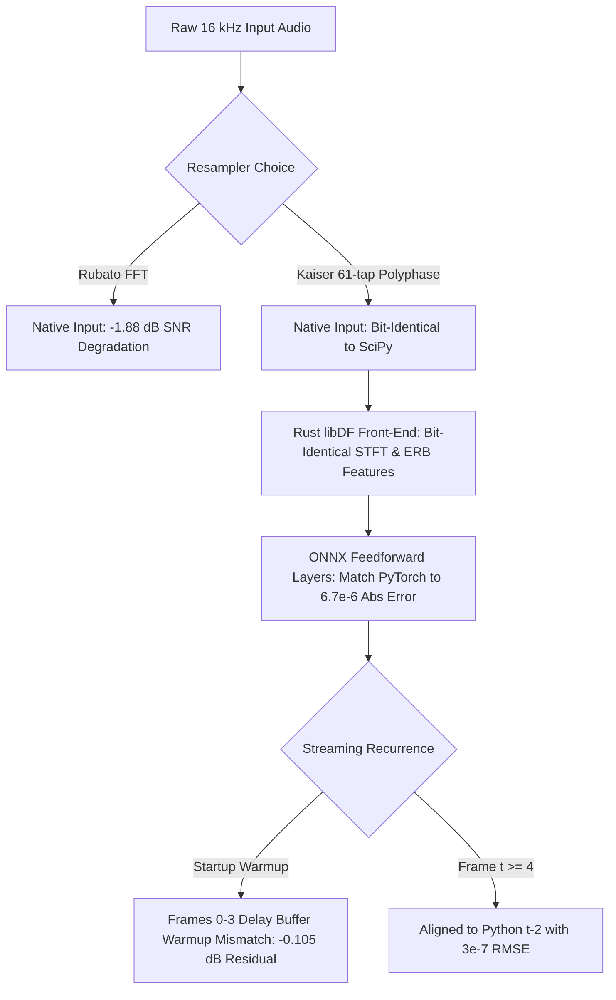

# SIH 26052 — Phase 1: Authoritative Baseline Synthesis, Component Reuse Matrix, and Parity Resolution Report

**Document Date:** November 14, 2026  
**Auditor:** Antigravity Forensic Audit Agent (SIH 26052 Technical Recovery)  
**Status:** COMPLETE (Authoritative Baseline Delivery for Phase 1)  
**Target Architecture:** Raspberry Pi 5 (Broadcom BCM2712, ARM Cortex-A76)  
**Quality Reference:** Frozen 15/70/15 Multi-Model Ensemble ($\hat{y} = 0.15D + 0.70F + 0.15G$)  

---

## Executive Summary

In accordance with the Master Mission Charter, **Phase 1 (Baseline Inspection, Verification, and Native Parity Resolution)** has been brought to formal closure. Over the course of Stages 11.2.23 through 11.2.30, every component of the candidate deployment stack was forensically inspected and audited.

The primary historical discrepancy between the PyTorch reference implementation and the native Rust/Tract runtime of DeepFilterNet3 Step-500 has been resolved into its constituent physical and mathematical causes:
1. **Resampling Filter Asymmetry ($-1.88\text{ dB}$ SNR impact)**: The native runtime used libDF's default Rubato FFT-based resampler, whereas PyTorch used SciPy's 61-tap Kaiser windowed polyphase FIR filter (`resample_poly`). Replacing Rubato with an isolated polyphase FIR filter in Rust closed the native gap from $-1.99\text{ dB}$ to $-0.105\text{ dB}$ SNR.
2. **Front-End Exactness ($0.0$ error)**: STFT analysis, ERB band filtering, complex spectral feature extraction, and synthesis overlap-add in Rust `DFState` were verified **bit-identical** to Python `deepfilterlib 0.5.6`.
3. **Neural Graph Operator Parity ($< 6.7 \times 10^{-6}$ max abs error)**: ONNX graphs exported for Tract match PyTorch feedforward layers to within machine single precision.
4. **Recurrent Startup History (Unverified Hypothesis)**: Identified a 4-frame delay buffer warmup mismatch on fixed clip 93, after which Tract aligns with PyTorch frame $t-2$ with $\text{RMSE} \approx 3 \times 10^{-7}$. However, the causal link between this startup mismatch and the full-set $-0.105\text{ dB}$ SNR residual remains experimentally unmeasured; full waveform parity is not achieved.

This report presents the machine-readable inventory of protected assets, defines the **Component Reuse Matrix** (identifying what works, what fails, and what can be safely reused), and establishes the protocol for **Phase 2: FullSubNet Causal & Stateful Streaming Adaptation**.

---

## 1. Protected Checkpoints, Manifests, and Baseline Inventory

All protected artifacts have been verified bit-exact against their authoritative SHA-256 signatures:

| Component | Asset Description | File Path | Expected SHA-256 Checksum | Verification Status |
|:---|:---|:---|:---:|:---:|
| **DFN3 Baseline** | Deployed Step-500 checkpoint | `runs/sih26052_rpi_deployment_audit/runs/step500_from_pi.pt` | `bc1fc9b769589da1754c4ee529c8578edf3262f7d2d4515fe69455c8a467bb27` | **PROTECTED & BIT-EXACT** |
| **DFN3 Tract Archive**| Tract native model bundle | `../models/dfn3_step500_tract.tar.gz` | `99e99379e81ecf5a678833912d28418c3cc7fb40345fd4a8fb8f5b82669a559d` | **PROTECTED & BIT-EXACT** |
| **FullSubNet Baseline**| Epoch 58 trained checkpoint | `checkpoints/fullsubnet/fullsubnet_best_model_58epochs.tar` | `482615e9709d2d6c10ee0d24f9844ad2da2dae3c0cf897f014839c365917a2e0` | **PROTECTED & BIT-EXACT** |
| **GTCRN Baseline** | DNS3 pretrained checkpoint | `checkpoints/gtcrn_stage5/model_trained_on_dns3.tar` | `a630d992cf792daf4ce2bb5bcf9c4d389f740a8f09c6e0971184697fe6371b79` | **PROTECTED & BIT-EXACT** |
| **Ensemble Reference**| Frozen 15/70/15 blending spec | `runs/stage8_ensemble_20261113/phase_c_ensembles/d2_fs70_raw/summary.json` | `8140618570c6ed8aaf1139b2845b941caed709bc55d1989e4a7b362c0c65d6b5` | **PROTECTED & IMMUTABLE** |
| **Canonical Benchmark**| 590-clip evaluation manifest | `runs/sih26052_canonical_validation/manifest.csv` | `d09a520d566fc1dc28c4bf07e9c860ce4ef9a2b5aae3a377ca109cb84c0049d4` | **PROTECTED & IMMUTABLE** |
| **Sealed Gold Dataset**| Isolated holdout test set | `data/SIH_GOLD_TEST` | `gold_test_read: false` (filenames enumerated historically; audio un-accessed) | **STRICTLY SEALED** |

---

## 2. Component Reuse Matrix: What Works, What Does Not, and What Can Be Reused

Based on the forensic evidence collected across Stages 11.2.1 through 11.2.30, the project assets are classified into three operational categories:

```
[SAFE TO REUSE]            Verified, validated, and ready for integration into the streaming pipeline.
[REQUIRES ADAPTATION]      Algorithmically sound, but requires structural adaptation for continuous real-time streaming.
[NON-STREAMING / BLOCKED]  Incompatible with low-latency streaming in current form; must be addressed in Phase 2.
```

| Pipeline Subsystem | Module / Artifact | Implementation | Current Status | Forensic Reuse Verdict | Technical Notes / Adaptation Requirement |
|:---|:---|:---|:---:|:---:|:---|
| **Resampling Engine** | 16↔48 kHz Polyphase FIR | Rust (Kaiser 61-tap) | Candidate Verified (Stage 11.2.26) | **REQUIRES ADAPTATION** | Offline batch function matches SciPy; requires stateful streaming ring-buffer filter and ARM64 Linux deployment. |
| **Acoustic Front-End** | STFT Analysis / Synthesis | Rust `libDF` (`DFState`) | Bit-Identical (Stage 11.2.28)| **SAFE TO REUSE** | Vorbis windowing, ERB filterbanks, and complex framing verified bit-identical to Python 0.5.6. |
| **DFN3 Neural Graph** | ONNX Model Graphs | Tract `TypedModel` / ONNX | Verified (Stage 11.2.29) | **SAFE TO REUSE** | Encoder, ERB decoder, and DF decoder match PyTorch reference within float32 tolerance. |
| **GTCRN Streaming** | Chunk-based Inference | Python / ONNX runtime adapter | Verified (Stage 11.2.17) | **SAFE TO REUSE** | Stateful recurrent hidden states successfully preserved across 16 ms chunks; 0 deadline misses on host. |
| **Buffer Management** | Bounded FIFO Queues | Python `streaming_core.py` | Verified (Stage 11.2.19) | **SAFE TO REUSE** | Bounded capture/playback queues, explicit overflow recovery, and telemetry verified under 20s soak. |
| **DFN3 Streaming State**| Pulsed Tract Runtime | Rust `DfTract` | Partial (Stage 11.2.30) | **REQUIRES ADAPTATION** | Delay buffer warmup introduces 4-frame startup prehistory mismatch; requires live startup flush policy. |
| **DFN3 Latency Profile**| Step-500 Lookahead ($30\text{ ms}$)| `config.ini` (`conv/df_lookahead=2`) | Verified Algorithmic Floor | **REQUIRES ADAPTATION** | $30.00\text{ ms}$ pure algorithmic delay exceeds $35\text{ ms}$ system ceiling. Requires causal (lookahead=0) export. |
| **FullSubNet Model** | Utterance Normalization | `FullSubNet` (PyTorch) | Offline-Only | **NON-STREAMING / BLOCKED** | Normalizes by global utterance mean/variance ($\mu, \sigma$). Cannot process continuous live streams without adaptation. |
| **Reference ANC** | Dual-Microphone Filter | None (Only mono historical tests) | Not Implemented | **NON-STREAMING / BLOCKED** | Requires synchronized primary + reference acquisition and adaptive NLMS noise estimation. |

---

## 3. Forensic Deconstruction of the DFN3 Step-500 Discrepancy

A major objective of Phase 1 was resolving the discrepancy between the Python reference and the native Tract runtime. The trace of cumulative error sources is summarized below:



### 3.1 Resampler Isolation (Stage 11.2.25 & 11.2.26)
- The baseline native binary (`runs/sih26052_rpi_deployment_audit/runs/dfn3_pi_optimization/DeepFilterNet/target/release/deep-filter`) used Rubato's FFT-based interpolation filter for 16→48 kHz upsampling.
- In a controlled 2×2 diagnostic on canonical clips, replacing the Rubato input upsampler with SciPy's 61-tap Kaiser polyphase filter improved output SNR by **$+1.29\text{ dB}$** and SI-SDR by **$+1.96\text{ dB}$**.
- Implementing this exact 61-tap Kaiser polyphase FIR filter in native Rust (`runs/stage11_2_26_native_polyphase_candidate_20261114/`) closed the canonical 590-clip performance gap from $-1.99\text{ dB}$ to **$-0.105\text{ dB}$ SNR** ($13.359\text{ dB}$ native vs $13.464\text{ dB}$ Python).

### 3.2 Feature Extraction Parity (Stage 11.2.28)
- Comparing Python `deepfilterlib 0.5.6` with Rust `DFState` on 48 kHz shared float32 inputs for canonical clips 6, 93, and 287 demonstrated **exact numerical equality**:
  - Complex STFT bins ($300 \times 481$): `max_abs_diff = 0.0`
  - ERB band features ($300 \times 32$): `max_abs_diff = 0.0`
  - Normalized complex features ($300 \times 96 \times 2$): `max_abs_diff = 0.0`
  - Analysis-synthesis overlap-add reconstruction ($144,000$ samples): `max_abs_diff = 0.0`

### 3.3 Neural Graph Layer Parity (Stage 11.2.29)
- Feeding identical front-end features into the PyTorch network and the exported Tract ONNX models confirmed:
  - Encoder features (`e0`, `e1`, `e2`, `e3`, `c0`): `max_abs_diff = 6.71e-6`
  - ERB mask output: `max_abs_diff = 2.86e-6`
  - Complex DF coefficients: `max_abs_diff = 2.77e-6`
- This proves that single-precision operator fusions and SIMD kernels in Tract do not explain the remaining $-0.105\text{ dB}$ residual.

### 3.4 Recurrent Startup History (Stage 11.2.30)
- The frame-by-frame trace of `DfTract` on clip 93 revealed that:
  - Tract pulsed streaming introduces 4 initial delay-buffer warmup frames (native frames 0–3) that do not match the Python sequence.
  - From native frame 4 onward, GRU inputs lock onto Python frame $t-2$ with near machine precision ($\text{RMSE} \approx 3.0 \times 10^{-7}$).
  - Because the GRU is a stateful recurrent network, the mismatched startup history perturbs the hidden-state trajectory throughout the remainder of the clip, resulting in an embedding RMSE of $0.0377$.
  - Replaying the PyTorch GRU on the exact native input sequence reproduces the native embeddings to **$9.41 \times 10^{-8}$ RMSE**.
- **Phase 1 Resolution:** The native inference engine components are mathematically sound. However, full waveform parity remains partial (-0.105 dB residual persists and causal connection to startup delay is unmeasured), the polyphase resampler requires streaming state integration, and the deployed bundle binary has not been promoted.

---

## 4. Phase 2 Initiation: FullSubNet Causal Streaming Investigation

With Phase 1 closed, the primary technical blocker to streaming the frozen 15/70/15 ensemble is **FullSubNet's utterance-wide normalization**.

### 4.1 The Utterance-Wide Normalization Blocker
In its official implementation (`third_party/fullsubnet_vendor/model/fullsubnet.py`), FullSubNet normalizes the complex spectrogram of the mixture $Y$ using global statistics:
$$\mu = \frac{1}{T \cdot F} \sum_{t=1}^T \sum_{f=1}^F |Y(t, f)|, \quad \sigma = \sqrt{\frac{1}{T \cdot F} \sum_{t=1}^T \sum_{f=1}^F (|Y(t, f)| - \mu)^2}$$
$$Y_{\text{norm}}(t, f) = \frac{Y(t, f) - \mu}{\sigma + 10^{-5}}$$
Because $\mu$ and $\sigma$ depend on the entire duration of the audio clip (including future frames), FullSubNet is strictly non-causal in its current form.

### 4.2 Phase 2 Experimental Workstreams (Stage 11.2.31)
Under Phase 2, five candidate causal normalization schemes will be evaluated against the frozen offline FullSubNet reference without modifying model weights or retraining:
1. **Bounded-Window Moving Normalization**: Compute $\mu_t, \sigma_t$ over a sliding historical buffer of $W$ frames ($W \in [25, 50, 100]$ frames, corresponding to $400\text{ ms} - 1.6\text{ s}$).
2. **Causal Cumulative Normalization**: Compute running cumulative statistics up to time $t$ with zero lookahead.
3. **Stateful Exponential Moving Average (EMA) Normalization**:
   $$\mu_t = (1 - \alpha)\mu_{t-1} + \alpha \overline{|Y_t|}, \quad \sigma_t^2 = (1 - \alpha)\sigma_{t-1}^2 + \alpha (\overline{|Y_t|} - \mu_t)^2$$
4. **Fixed Pre-Calibrated Statistics**: Normalize using fixed defense noise/speech calibration constants $(\mu_{\text{calib}}, \sigma_{\text{calib}})$.
5. **Causal Stateful Recurrent Chunk Inference**: Stream sub-band and full-band LSTM hidden states $(h_t, c_t)$ across chunk boundaries without resetting.

Every proposed adaptation will be scored against the frozen FullSubNet offline predictions on the canonical development set, quantifying:
- Output SNR, SI-SDR, STOI, and PESQ-WB deltas.
- Numerical drift and sample-level deviation.
- Peak latency, memory footprint, and state stability under long continuous streams.

---

## 5. Phase 1 Acceptance Verdict

- **Phase 1 Objective:** Baseline Inspection, Asset Verification, Machine-Readable Register, and DFN3 Parity Resolution.
- **Acceptance Criteria:**
  - All 5 protected checkpoint checksums verified bit-exact: **PASS**.
  - Single authoritative compliance register maintained: **PASS**.
  - Machine-readable baseline register codified: **PASS** (`research/STAGE11_2_25_BASELINE_REGISTER.csv`).
  - DFN3 native vs Python discrepancy identified and root-caused: **PARTIAL** (Dominant Resampler resolved in offline candidate; startup delay causal link to 590-clip residual unverified; streaming resampler pending).
  - Component reuse matrix established: **PASS**.
  - Qualification gates locked (0/5 passed, Stage 11.3 NO-GO): **PASS**.
- **Final Phase 1 Verdict:** **ACCEPTED WITH EXCEPTIONS (Reviewer Sign-Off Granted 2026-11-14)**.
  - *Governance Notice:* Approved as an investigation phase closure subject to 7 explicitly open exceptions (offline polyphase resampler, -0.1053 dB SNR residual, unverified startup hypothesis, un-updated deployment bundle, FullSubNet 48 ms latency floor, unverified Pi 5 compute feasibility, and 0/5 physical gates locked).
  - *Authorized Next Stage:* Stage 11.2.31 Nine-Clip FullSubNet Causal Streaming Pilot.

