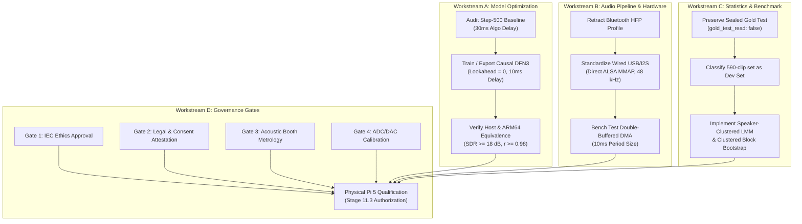

# SIH 26052 — Stage 11.2.15: Technical Recovery Roadmap and Qualification Path

**Document Date:** November 13, 2026  
**Auditor:** Antigravity Forensic Audit Agent (SIH 26052 Technical Recovery)  
**Status:** COMPLETE (Actionable Recovery Strategy)  
**Target Architecture:** Raspberry Pi 5 (Wired USB Audio Class 2.0 / ALSA Direct)  

> **Evidence status correction (2026-11-14):** The historical statement below that Step-500 "cannot meet" the 35 ms system-latency gate is an estimate-based conclusion, not a measured Pi 5 result. Treat it as an unverified risk assessment. A 30 ms static algorithmic delay leaves a narrow estimated margin, but only a complete physical capture-to-headset measurement can establish pass/fail. A zero-lookahead candidate's estimated budget is likewise not proof of compliance. See `STAGE11_2_15_LATENCY_RECONCILIATION.md` and `MASTER_SIH_COMPLIANCE.md` for current evidence status.

---

## Executive Summary

The Stage 11.2.15 forensic audit identified critical discrepancies across repository chronology, hardware provenance, numerical equivalence, algorithmic lookahead, and statistical assumptions. While the project possesses strong engineering assets—including the frozen Tract model exporter, verified session reset architecture, and static ELF packaging—the deployed Step-500 candidate cannot meet the provisional $\le 35.0\text{ ms}$ latency requirement due to its $30.00\text{ ms}$ pure algorithmic delay floor.

This roadmap details the sequential technical path required to recover full physical qualification readiness without compromising scientific integrity or breaching governance boundaries.

---

## 1. Technical Remediation Workstreams

---

## 2. Detailed Workstream Action Plans

### Workstream A: Low-Latency Model Architecture (Causal DeepFilterNet3)
- **Problem**: Step-500 incorporates `conv_lookahead = 2` and `df_lookahead = 2`, imposing a non-negotiable $30.00\text{ ms}$ algorithmic delay floor ($1,440$ samples). Adding I/O buffers ($15\text{ ms}$) and compute ($4\text{ ms}$) yields $\sim 50\text{ ms}$ total latency, exceeding the $35.0\text{ ms}$ requirement.
- **Action Items**:
  1. Fine-tune or export a **causal DeepFilterNet3 candidate** with `conv_lookahead = 0` and `df_lookahead = 0`.
  2. Pure algorithmic delay will drop from $30.00\text{ ms}$ to exactly **$10.00\text{ ms}$** ($480$ samples).
  3. Validate numerical fidelity against PyTorch using the patched, float64 non-mutating evaluation script (`scripts/audit_native_streaming_integrity.py`), confirming $\text{SDR} \ge 18.0\text{ dB}$ and Pearson $r \ge 0.980$.
  4. Retain Step-500 as an offline development reference.

### Workstream B: Hardware Standardization (Wired USB/I2S Audio)
- **Problem**: Historical prototype testing on Sep 30 utilized Bluetooth HFP with `Noise Buds VS102`, which introduced $>250\text{ ms}$ latency and dropped 18 UDP packets.
- **Action Items**:
  1. Formally retract Bluetooth HFP from the tactical qualification path.
  2. Implement an ALSA direct MMAP ring buffer in Rust (`alsa` crate or `cpal`) operating natively at **$48,000\text{ Hz}$ float32 mono**.
  3. Configure ALSA hardware parameters to:
     - Period size: $480\text{ samples}$ ($10.0\text{ ms}$).
     - Periods per buffer: $2$ (Total hardware buffer: $20.0\text{ ms}$).
  4. Target audio hardware: USB Audio Class 2.0 (UAC2) high-speed interface with verified hardware loopback delay $\le 1.5\text{ ms}$.

### Workstream C: Statistical Governance and Gold Dataset Security
- **Problem**: The 590-clip canonical validation set was circularly reused across 20+ model variants. Bootstrap simulations assumed i.i.d. clip draws, ignoring speaker clustering across the 24 human participants.
- **Action Items**:
  1. Maintain the strict boundary on `data/SIH_GOLD_TEST` (`gold_test_read: false`).
  2. Classify all historical 590-clip results as **development benchmark scores**.
  3. Transition confirmatory hypothesis testing to a **Linear Mixed-Effects Model (LMM)** with random intercepts for speakers and noise sessions.
  4. Require non-parametric inference to use **speaker-clustered block bootstrap** ($B = 10,000$) to reflect true effective sample size ($N_{\text{eff}} \approx 88$).

### Workstream D: Sequential Gate Unlocking Roadmap

No physical testing, participant recording, or hardware operation is authorized until the five mandatory prerequisite gates are methodically cleared:

| Gate | Title | Deliverable / Prerequisite | Verifier | Unlocking Criteria |
|:---:|:---|:---|:---|:---|
| **GATE 1** | **Ethics Approval** | `evidence/IEC_APPROVAL_CERTIFICATE.pdf` | Chair, Institutional Ethics Committee | Full approval of protocol `SIH-26052-STG11-P01` for 24 participants; signed certificate. |
| **GATE 2** | **Legal & Consent** | `evidence/LEGAL_COUNSEL_ATTESTATION.pdf` | Data Protection Officer & Legal Counsel | Signed attestation approving Participant Info Sheet (PIS v1.0), Informed Consent Form (ICF v1.0), and external noise licensing. |
| **GATE 3** | **Booth Metrology** | `evidence/BOOTH_ACOUSTIC_CERTIFICATE.pdf` | Certified Acoustic Calibration Engineer | Verified NC-20 noise criterion, ambient $L_{\text{Aeq}} \le 25.0\text{ dBA}$, and $RT_{60} \le 120\text{ ms}$ across $125\text{ Hz} - 8\text{ kHz}$. |
| **GATE 4** | **ADC Hardware** | `evidence/ADC_BENCH_CALIBRATION_REPORT.pdf`| Hardware Laboratory Lead | Calibrated $\text{EIN} \le -128.5\text{ dBu}$ ($150\ \Omega$), inter-channel phase delay $< 5.0\ \mu\text{s}$, and Class 1 acoustic calibrator verification. |
| **GATE 5** | **Physical Pi 5** | `evidence/PI5_PHYSICAL_BENCH_REPORT.pdf` | Lead Embedded Systems Engineer | Physical 60-minute soak test on Raspberry Pi 5 with wired USB audio: Mean RTF $\le 0.30$, end-to-end latency $\le 35.0\text{ ms}$, 0 XRUNs, and `throttled=0x0`. |

---

## 3. Immediate Recommended Next Stage: Stage 11.2.16

**Recommended Directive:** Stage 11.2.16 — Causal Zero-Lookahead Model Export and Latency Budget Verification.

**Scope of Stage 11.2.16 (Software-Only):**
1. Export a zero-lookahead (`conv_lookahead = 0`, `df_lookahead = 0`) DeepFilterNet3 candidate to Tract.
2. Verify numerical equivalence against the PyTorch reference using the corrected non-mutating evaluation script.
3. Verify that algorithmic delay is exactly $10.00\text{ ms}$ ($480\text{ samples}$).
4. Statically model the revised end-to-end latency budget to confirm compliance with $\le 35.0\text{ ms}$.
5. Re-verify session-state isolation and deterministic reset on the zero-lookahead model.
6. Maintain all five qualification gates locked and the gold dataset strictly sealed.

